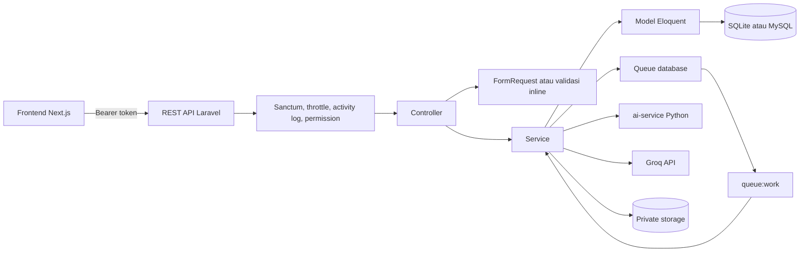
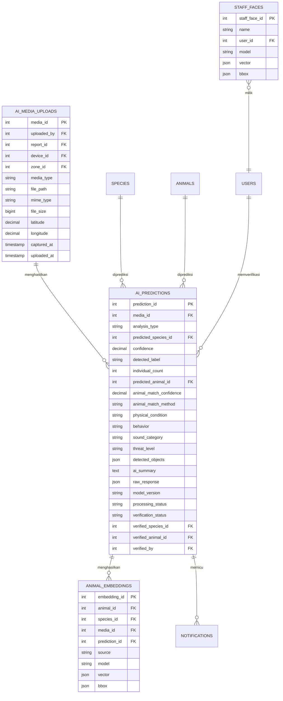
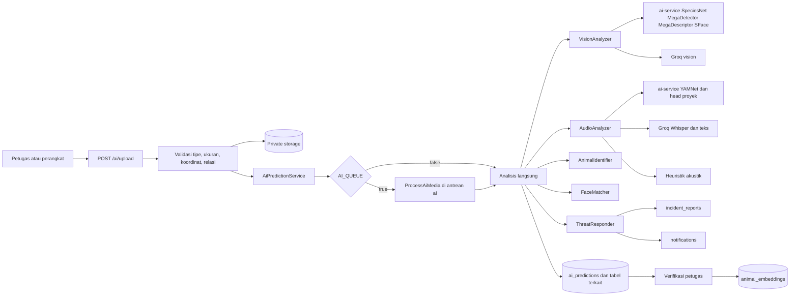
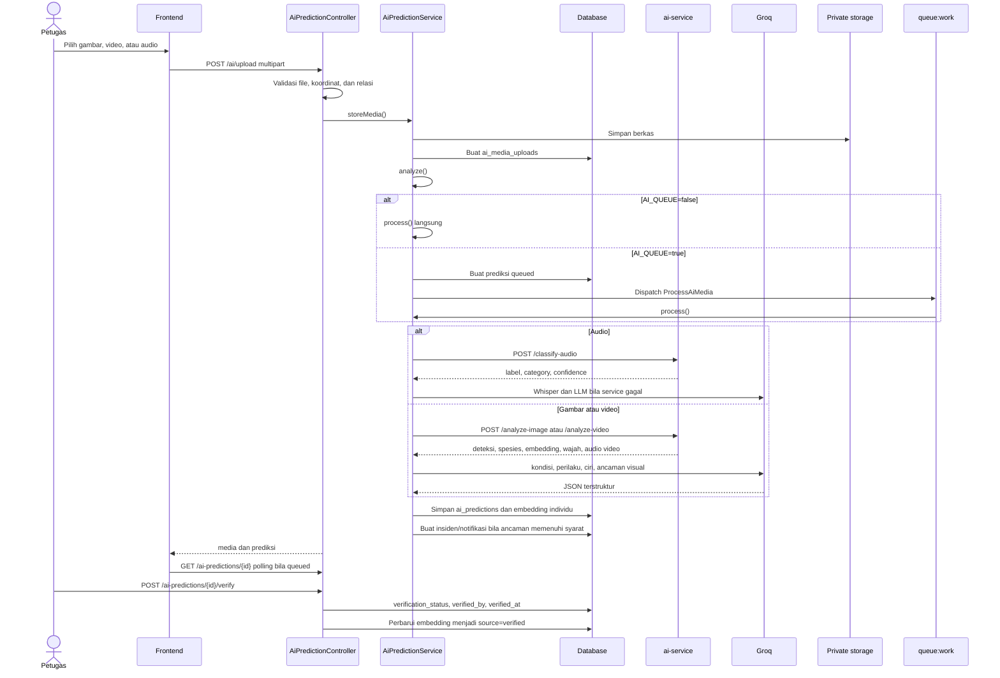

# Wildlife Monitoring System — Backend

Dokumentasi berbasis kode sumber untuk `wildlife-tracking-backend`. Pemeriksaan terakhir: 2026-11-28. Laravel dan seluruh perintah di bawah dijalankan dari root repository ini.

## 1. Ringkasan Proyek

Repository ini adalah REST API dan lapisan data untuk Wildlife Monitoring System Balai Taman Nasional Gunung Leuser. Backend menyimpan data satwa, spesies, perangkat, pembacaan GPS, zona, insiden, notifikasi, laporan, pengguna, serta data wisata dan tiket. Backend juga menjadi satu-satunya tempat yang menyimpan kunci penyedia AI, menjalankan pipeline analisis media, menyimpan berkas privat, dan menulis hasil prediksi ke database.

Backend dibangun dengan Laravel 13 dan Sanctum. Frontend memakai bearer token, bukan sesi cookie Laravel. Setiap rute API didefinisikan dua kali oleh `routes/api.php`: tanpa prefiks versi (`/api/...`) yang dipakai frontend saat ini, dan dengan prefiks `/api/v1/...` sesuai dokumentasi analisis kebutuhan.

## 2. Fakta Versi

Versi diambil dari `composer.json`; rentang `^` ditampilkan apa adanya.

| Komponen | Versi |
| --- | --- |
| PHP | `^8.3` |
| Laravel Framework | `^13.17` |
| Laravel Sanctum | `^4.3` |
| Guzzle | `^8.3` |
| Predis | `^3.7` |
| Pest | `^4.7` |
| PHPUnit | `^12.5.12` |
| Laravel Pint | `^1.27` |
| Scramble | `^0.13.51` |
| Vite/Tailwind frontend admin | dari `package.json`, hanya untuk halaman welcome |

Tidak ada skrip Composer bernama `lint` atau `typecheck`. Formatting memakai `vendor/bin/pint`, sedangkan pengujian memakai `composer test` atau `php artisan test`.

## 3. Arsitektur Umum



Fakta arsitektur penting:

- `bootstrap/app.php` mendaftarkan middleware alias `role`, `permission`, dan `log.activity`, lalu menambahkan `SecurityHeaders` pada grup API.
- Pengecualian API dinormalisasi menjadi `{ success: false, message, errors }`; respons sukses umum adalah `{ success: true, message: "OK", data, errors: null }`.
- `App\Http\Traits\ApiResponse::list()` menghasilkan array `data` dan header `X-Total-Count`, `X-Current-Page`, `X-Per-Page`, `X-Last-Page`, dengan batas `maxPerPage = 200`.
- Model, controller, FormRequest, ApiResource, dan Service telah tersedia, tetapi banyak controller masih memakai validasi inline dan `response()->json()` langsung. Resource dan trait tidak selalu dipakai.
- Seluruh rute berada di dalam grup `auth:sanctum`, `RestrictDeviceTokens`, dan `log.activity`, kecuali auth dan endpoint publik yang disebut di bagian API.
- Otorisasi memakai permission dari tabel `role_permissions`, bukan sekadar nama role.

## 4. Struktur Direktori

```text
wildlife-tracking-backend/
├── app/
│   ├── Console/Commands/            perintah jadwal dan perbaikan data
│   ├── Http/Controllers/Api/       controller REST API
│   ├── Http/Middleware/            auth perangkat, RBAC, keamanan, timeout API
│   ├── Http/Resources/             resource API, sebagian belum dipakai
│   ├── Http/Traits/                ApiResponse
│   ├── Jobs/                       ProcessAiMedia dan worker lain
│   ├── Models/                     model domain Eloquent
│   ├── Services/                   orkestrasi bisnis dan AI
│   └── Services/Ai/                analyzer, matcher, responder, klien model
├── ai-service/                     microservice Python untuk model terlatih
│   ├── models/                     checkpoint YAMNet, SpeciesNet, MegaDescriptor, wajah
│   ├── heads/                      classifier suara hasil pelatihan proyek
│   ├── training/                   skrip latih, evaluasi, dan laporan uji
│   ├── app.py                      server FastAPI
│   └── README.md                   dokumentasi layanan AI
├── config/                         konfigurasi Laravel, termasuk services.php
├── database/
│   ├── factories/
│   ├── migrations/
│   └── seeders/
├── docs/                           dokumentasi tambahan proyek
├── routes/
│   ├── api.php                     seluruh endpoint REST
│   └── console.php                 penjadwalan perintah
├── scripts/
│   ├── setup-ai-service.ps1        instalasi model AI di Windows
│   └── start-server.ps1            Laravel + worker + ai-service + tunnel
├── storage/app/ai-media/           berkas media privat hasil unggahan
└── tests/                          Pest/PHPUnit feature dan unit test
```

## 5. Integrasi dengan Frontend

Frontend Next.js berada di repository bersebelahan. Alur permintaannya adalah `page → hook → service → services/api.ts → Server Action → Laravel /api`. Frontend tidak memiliki route handler Next.js atau middleware; satu-satunya Server Action ada di `services/backend-actions.ts` dan membaca cookie httpOnly `wms_token` sebelum menambahkan header bearer.

Frontend menargetkan root API `http://127.0.0.1:8000/api`. Variable `FRONTEND_URLS` di backend mengontrol origin yang diperbolehkan CORS. Bila frontend dan backend berbeda host melalui tunnel, `FRONTEND_URLS` harus diperbarui. `TRUSTED_PROXIES` mengontrol apakah backend mempercayai `X-Forwarded-For` dari reverse proxy untuk rate limiting.

## 6. Instalasi

Persyaratan: PHP 8.3+, Composer, Node.js untuk build aset admin, SQLite atau MySQL, dan opsional Python 3.11/3.12 untuk ai-service.

```bash
cd wildlife-tracking-backend
composer install
cp .env.example .env
php artisan key:generate
php artisan migrate --seed
php artisan serve
```

`composer setup` menjalankan `composer install`, membuat `.env`, `key:generate`, `migrate --force`, `npm install --ignore-scripts`, dan `npm run build`. Gunakan hanya bila kondisi awal repository sesuai.

Secara bawaan `.env.example` memakai `DB_CONNECTION=sqlite`. Untuk MySQL, ubah koneksi dan kredensial di `.env` sebelum migrasi. Jangan pernah meng-commit `.env`.

## 7. Konfigurasi Lingkungan

Berikut adalah variabel yang benar-benar dibaca dari `.env.example`, `config/services.php`, dan kode terkait.

### Aplikasi dan Keamanan

| Variabel | Default | Fungsi |
| --- | --- | --- |
| `APP_NAME` | `Laravel` | Nama aplikasi |
| `APP_ENV` | `local` | Lingkungan aplikasi |
| `APP_KEY` | kosong | Kunci enkripsi; wajib diisi via `php artisan key:generate` |
| `APP_DEBUG` | `true` | Detail error; matikan di produksi |
| `TRUSTED_PROXIES` | kosong | IP proxy yang dipercaya untuk header forwarded |
| `APP_URL` | `http://localhost:8000` | URL kanonik backend |
| `APP_LOCALE`, `APP_FALLBACK_LOCALE`, `APP_FAKER_LOCALE` | `en`, `en`, `en_US` | Lokalisasi Laravel |
| `BCRYPT_ROUNDS` | `12` | Biaya hash kata sandi |
| `LOG_CHANNEL`, `LOG_STACK`, `LOG_LEVEL` | `stack`, `single`, `debug` | Logging |
| `SESSION_DRIVER`, `SESSION_LIFETIME` | `database`, `120` | Sesi Laravel |
| `API_IDLE_TIMEOUT` | `120` | Batas idle token API dalam menit |
| `FRONTEND_URLS` | `http://localhost:3000,http://127.0.0.1:3000` | Origin frontend yang diizinkan CORS |
| `SESSION_ENCRYPT`, `SESSION_PATH`, `SESSION_DOMAIN` | `false`, `/`, `null` | Opsi sesi |

### Database, Antrean, Cache, dan Storage

| Variabel | Default | Fungsi |
| --- | --- | --- |
| `DB_CONNECTION` | `sqlite` | Koneksi utama |
| `DB_HOST`, `DB_PORT`, `DB_DATABASE`, `DB_USERNAME`, `DB_PASSWORD` | komentar | Diperlukan bila memakai MySQL |
| `BROADCAST_CONNECTION` | `log` | Broadcast |
| `FILESYSTEM_DISK` | `local` | Disk bawaan; AI memaksa disk `local` |
| `QUEUE_CONNECTION` | `database` | Antrean, termasuk `ProcessAiMedia` |
| `CACHE_STORE` | `database` | Cache untuk idle timeout dan rate limit terkait |
| `MEMCACHED_HOST` | `127.0.0.1` | Memcached |
| `REDIS_CLIENT`, `REDIS_HOST`, `REDIS_PASSWORD`, `REDIS_PORT` | `phpredis`, `127.0.0.1`, `null`, `6379` | Redis |
| `MAIL_*`, `AWS_*`, `VITE_APP_NAME` | bawaan Laravel | Mail, filesystem cloud, dan aset frontend admin |

### AI

| Variabel | Default | Fungsi |
| --- | --- | --- |
| `GROQ_API_KEY` | kosong | Kunci Groq; rahasia, hanya di backend |
| `GROQ_VISION_MODEL` | `qwen/qwen3.8-27b` | Model vision Groq |
| `GROQ_TEXT_MODEL` | `qwen/qwen3.8-27b` | Model teks Groq |
| `GROQ_AUDIO_MODEL` | `whisper-large-v3-turbo` | Model transkripsi Groq |
| `GROQ_TIMEOUT` | `60` | Timeout permintaan Groq |
| `AI_AUDIO_SERVICE_URL` | `http://127.0.0.1:8001` | Endpoint ai-service untuk audio |
| `AI_AUDIO_SERVICE_MODEL` | `yamnet-audioset-v1+wt-heads-v1` | Label model audio yang dicatat di prediksi |
| `AI_AUDIO_SERVICE_TOKEN` | kosong | Token opsional untuk ai-service |
| `AI_VISION_SERVICE_URL` | `http://127.0.0.1:8001` | Endpoint ai-service untuk vision dan embedding |
| `AI_VISION_SERVICE_TOKEN` | fallback ke token audio | Token opsional untuk ai-service vision |
| `AI_AUDIO_SERVICE_TIMEOUT` | `60` dari kode | Timeout klien audio |
| `AI_VISION_SERVICE_TIMEOUT` | `180` dari kode | Timeout klien vision |
| `AI_COUNTRY` | `IDN` | Filter geografis SpeciesNet |
| `AI_REID_THRESHOLD` | `0.6` | Ambang kemiripan individu |
| `AI_FACE_THRESHOLD` | `0.40` | Ambang staf dikenali |
| `AI_FACE_POSSIBLE_THRESHOLD` | `0.30` | Bawah rentang kemungkinan staf |
| `AI_QUEUE` | `false` | `true` memindahkan analisis ke worker |
| `FFMPEG_PATH` | `ffmpeg` | Ekstraksi frame video untuk Groq |

### Wisata dan Simulasi

| Variabel | Default | Fungsi |
| --- | --- | --- |
| `MIDTRANS_SERVER_KEY` | kosong | Kosong berarti Midtrans nonaktif |
| `MIDTRANS_IS_PRODUCTION` | `false` | Mode Midtrans |
| `MIDTRANS_FINISH_URL` | `http://localhost:3000/bookings` | URL selesai pembayaran |
| `PAYMENT_SIMULATOR_ENABLED` | `true` | Simulator QRIS/VA/e-wallet; matikan di produksi nyata |
| `GPS_SIMULATOR_ENABLED` | `true` | Menambah satu titik GPS simulasi per kalung per 10 detik |
| `TOURISM_TIMEZONE` | `Asia/Jakarta` | Zona waktu wisata |
| `TOURISM_PAYMENT_WINDOW_MINUTES` | `60` | Batas pembayaran sebelum kuota dilepas |
| `TOURISM_BANK_*`, `TOURISM_QRIS_MERCHANT_NAME` | kosong | Informasi transfer yang ditampilkan ke pengunjung |
| `PAYMENT_WEBHOOK_SECRET` | kosong | Rahasia HMAC webhook; kosong berarti webhook ditolak |

Kunci API, token, dan kata sandi tidak boleh tampil di frontend, log, atau respons API.

## 8. Autentikasi dan Otorisasi

### Autentikasi

- `POST /login` dan `POST /auth/login` memakai `throttle:20,1,auth`; keduanya memanggil `AuthController@login`.
- `POST /register` memakai `throttle:5,1,register`, tantangan aritmetika, dan honeypot. Role pendaftar selalu `pengunjung`.
- Token Sanctum disimpan di `personal_access_tokens`. Login mencabut token lama pengguna sebelum menerbitkan token baru.
- `GET /me`, `GET /auth/me`, logout, refresh, profil, dan perubahan kata sandi berada di bawah `auth:sanctum`.
- `RestrictDeviceTokens` membatasi token perangkat agar tidak dapat memakai endpoint akun stakeholder.
- `tokens:prune-idle` dijalankan tiap jam oleh scheduler untuk mencabut token yang melewati `API_IDLE_TIMEOUT`.

### Role dan Permission

`database/seeders/RolePermissionSeeder.php` adalah sumber kebenaran. Terdapat 15 permission dan 6 role.

| Role | Cakupan permission |
| --- | --- |
| `konservasionis_lapangan` | `view_data`, `create_data`, `update_data`, `upload_media`, `verify_ai`, `validate_tickets` |
| `peneliti_ekologi` | `view_data`, `create_data`, `update_data`, `view_reports`, `manage_master_data`, `upload_media`, `verify_ai`, `export_data` |
| `administrator_sistem` | seluruh permission |
| `pengambil_kebijakan` | `view_data`, `view_reports`, `upload_media`, `export_data` |
| `petugas_loket` | `sell_tickets`, `validate_tickets` |
| `pengunjung` | `book_tickets` |

Permission tidak dikelola lewat API. Role dapat dikelola melalui rute `manage_roles`. Galeri wajah staf berada di bawah `manage_users` karena memuat data biometrik.

## 9. Database dan Seeding

Migrasi memakai schema builder dan primary key domain seperti `species_id`, `animal_id`, `device_id`, dan `prediction_id`. Diagram berikut hanya menampilkan tabel yang paling relevan untuk alur AI.



Catatan basis data:

- `ai_predictions` memiliki `unique(media_id, model_version)`. Retry memperbarui baris yang sama atau mengganti versi bila diperlukan.
- `analysis_type` hanya bernilai `image` atau `audio`. Media video tetap dianalisis sebagai `image`, dengan video asli dikirim ke ai-service bila tersedia.
- `processing_status`: `queued`, `processing`, `completed`, `failed`, `unrecognized`.
- `verification_status`: `pending`, `confirmed`, `rejected`.
- `threat_level`: `none`, `low`, `medium`, `high`, `critical`.
- `notifications.prediction_id` memiliki foreign key ke `ai_predictions`.
- Berkas media disimpan di disk privat `local` pada pola `storage/app/ai-media/{image|video|audio}/Y/m/...`.
- `raw_response` disembunyikan pada daftar, tetapi dibuka saat endpoint detail.
- Seeder dijalankan berurutan oleh `DatabaseSeeder`: `RolePermissionSeeder`, `UserSeeder`, `SpeciesSeeder`, `GeoZoneSeeder`, `AnimalSeeder`, `TrackingDeviceSeeder`, `GpsReadingSeeder`, `IncidentReportSeeder`, `NotificationSeeder`, `AiSampleSeeder`, dan `TourismSeeder`.
- `RolePermissionSeeder` bersifat `updateOrCreate` dan aman diulang. Seeder domain lain umumnya memakai `insert()` dengan primary key tetap dan tidak dirancang untuk dijalankan setelah import SQL.

## 10. Permintaan, Respons, dan Format Error

Envelope sukses umum:

```json
{
  "success": true,
  "message": "OK",
  "data": {},
  "errors": null
}
```

Envelope daftar memuat array pada `data` dan header pagination. Validasi Laravel menghasilkan status 422 dengan objek `errors` per field. Frontend memetakan field error tersebut ke form alert.

Semua rute didaftarkan dua kali oleh closure `$routes()` di `routes/api.php`: sekali tanpa prefiks dan sekali di dalam `Route::prefix('v1')`.

## 11. Permukaan API

### Publik

- `POST /login`, `POST /auth/login`
- `POST /register`, `GET /register/challenge`
- `GET /tourism/routes`, `/tourism/routes/{slug}`, `/tourism/routes/{slug}/safety`, `/tourism/guides`, `/tourism/guides/{id}`, `/tourism/guides/{id}/photo`, `/tourism/schedule`, `/tourism/prices`, `POST /tourism/quote`, `GET /tourism/payment-info`
- `GET /wildlife/species`, `/wildlife/species/{id}`, `/wildlife/species/{id}/model`
- `POST /payments/midtrans/notification`, `POST /payments/webhook`

### Autentikasi dan Profil

- `POST /logout`, `POST /auth/logout`, `POST /auth/refresh`
- `GET /me`, `GET /auth/me`, `GET /users/me`
- `PATCH /me`, `PATCH /users/me`, `PUT /me/password`, `PUT /users/me/password`

### Data Konservasi dan Lapangan

- `GET /dashboard`, `/dashboard/stats`, `/dashboard/charts`
- `GET/POST /species`, `/animals`, `/devices` atau `/tracking-devices`, `/geo-zones`, `/gps-readings`, `/animal-geo-zone-visits`, `/incidents` atau `/incident-reports`, `/weather-data`
- Detail dan variasi: `/{id}`, `animals/{id}/track`, `animals/{id}/zone-visits`, `animals/{id}/incidents`, `animals/{id}/ai-observations`, `animals/{id}/reference-photos`, perangkat `latest-reading`, `gps-readings`, `battery-history`, `captures`, `telemetry`, `api-token`, zona `animals`, `visits`, `devices`, serta `gps-readings/{id}/weather`
- Mutasi tambahan: `PATCH animals/{id}/status`, assign dan unassign perangkat, update condition/status, bulk GPS, exit kunjungan zona, upload media insiden, update sync status, ingest dan sync cuaca

### Administrasi dan Laporan

- `GET/POST/PUT/PATCH/DELETE /users`, `users/{id}/activity`, `users/{id}/tokens`, `users/{id}/status`
- `GET/POST/PUT/DELETE /roles`, `roles/{id}/permissions`, `permissions`
- `GET /activity-logs`, `/activity-logs/{id}`
- `GET/POST /aggregate-reports`, `/aggregate-reports/generate`, detail dan download
- `GET /export/gps/*`, `/export/animals/csv`, `/export/species/csv`, `/export/devices/csv`, `/export/incidents/csv`, `/export/weather/csv`, `/export/ai-predictions/csv`, `/export/geo-zones/*`, `/export/zone-visits/csv`, `/export/aggregate-report/{id}`, `/export/users/csv`, `/export/activity-logs/csv`
- Notifikasi milik sendiri: `GET /notifications`, `/unread-count`, detail, `PATCH read/read-all`, dan `DELETE`

### AI

Lihat bagian khusus AI di bawah untuk penjelasan alur. Endpointnya adalah:

- `GET /ai-predictions`, `/ai-predictions/pending-verification`, `/ai-predictions/{id}`
- `GET /media-uploads`, `/media-uploads/{id}`, `/media-uploads/{id}/file`, `/media-uploads/{id}/predictions`
- `GET /ai/summary-report`, `/ai/recap`, `/ai/health`, `/ai/threats`, `/ai/vocabulary`
- `POST /ai/upload`, `POST /media-uploads`, `POST /ai/detect-objects`, `POST /media-uploads/{id}/predictions`
- `POST` atau `PATCH /ai-predictions/{id}/verify`, `POST /ai-predictions/{id}/retry`
- `DELETE /ai-predictions/{id}` dan `DELETE /media-uploads/{id}`, keduanya memerlukan `delete_data`

### Wisata dan POS

- `POST /tourism/routes/{slug}/emergency-alert` dengan throttle khusus
- `GET/POST /visitor/bookings`, detail, cancel, payment-proof, ticket, pay-online, simulate-payment, dan review
- `POST /tourism/check-in`, `GET /tourism/check-in/today`
- `GET /pos/session`, `POST /pos/session/open`, `/close`, `GET /pos/sessions`, `/sales`, `POST /pos/sales`, void, `GET /pos/report`
- `GET/POST/PUT/DELETE /tourism/admin/routes|guides|shifts|prices|holidays|bookings|payments|reviews`

Daftar lengkap dan parameternya ada di [`docs/API.md`](docs/API.md).

## 12. Modul AI

### Gambaran Umum

Pipeline AI mengubah media lapangan menjadi prediksi yang dapat diverifikasi manusia. Backend tidak pernah memanggil penyedia AI dari frontend dan tidak pernah menyimpan kunci AI di klien. Backend juga tidak menganggap output AI sebagai keputusan akhir: status verifikasi dan identitas petugas selalu dicatat.



### Model dan Provider yang Digunakan

| Komponen | Model atau penyedia | Peran | Status |
| --- | --- | --- | --- |
| Deteksi objek | MegaDetector v5a via SpeciesNet v4.0.3a | Mendeteksi satwa, manusia, kendaraan, dan jumlah individu | Pretrained; dipanggil lewat ai-service |
| Klasifikasi spesies | SpeciesNet v4.0.3a Google | Memberi label spesies atau takson lebih umum | Pretrained; filter negara `IDN` |
| Re-identifikasi satwa | MegaDescriptor-T-224 | Embedding 768 dimensi untuk mencocokkan individu | Pretrained; ambang kosin `0.6` |
| Deteksi wajah | YuNet OpenCV | Menemukan wajah pada foto/video | Pretrained |
| Embedding wajah | SFace OpenCV | Embedding 128 dimensi untuk galeri staf | Pretrained |
| Audio dasar | YAMNet Google AudioSet | Fitur dan 521 label suara dasar | Pretrained (`models/yamnet.h5`, `models/yamnet_class_map.csv`) |
| Detektor tembakan | `heads/gunshot_head.npz` | Klasifikasi biner tembakan | Dilatih proyek ini |
| Kategori suara | `heads/category_head.npz` | Klasifikasi kategori suara lapangan | Dilatih proyek ini |
| Kondisi, perilaku, ciri pembeda, ancaman visual | Groq vision | Analisis yang belum punya model terlatih publik | Layanan eksternal berbayar/terkonfigurasi |
| Transkrip dan klasifikasi audio teks | Groq Whisper + model teks | Fallback bila ai-service tidak tersedia | Layanan eksternal |
| Heuristik akustik | `AudioFeatureExtractor` | Fallback offline terakhir | Akurasi terbatas |

File model tidak ikut di-commit. `scripts/setup-ai-service.ps1` atau `python download_model.py` mengunduhnya dari sumber resmi ke `ai-service/models/`. Kelas `heads/` berasal dari pelatihan proyek dan tersimpan di repository.

### Status Pelatihan dan Evaluasi

Pelatihan dan evaluasi berada di `ai-service/training/README.md`. Angka berikut adalah hasil uji yang dilaporkan sumber tersebut pada 2026-11-22, bukan hasil pengukuran ulang dalam dokumentasi ini:

- Kategori suara: akurasi 96,1% pada 2.548 klip uji.
- Tembakan: 85% tertangkap dengan 1,3% alarm palsu dari suara alam/satwa.
- MegaDetector: 79/90 foto bersatwa terdeteksi dan 0/20 foto kosong salah deteksi.
- MegaDescriptor: top-1 97,9% pada 107 harimau ATRW; angka ini diakui optimistis karena kemungkinan ada data ATRW dalam data latih model.
- Pengenalan wajah staf memakai pendaftaran embedding, bukan fine-tuning jaringan, karena jumlah foto staf terlalu kecil. Ambang `0.40` dipakai agar orang lain tidak mudah lolos sebagai staf.

Dataset yang dicatat berasal dari Zenodo gunshot PAM, Lund anti-poaching, ESC-50, SWG Camera Traps, dan ATRW. Data tidak di-commit. Kondisi fisik, perilaku, dan tanda senjata/jerat/penebangan/api belum memiliki model terlatih untuk satwa Sumatra; bagian ini memakai Groq vision dan wajib diverifikasi petugas. Badak, gajah, dan orangutan Sumatra belum diuji dengan foto lapangan Sumatra nyata.

MegaDescriptor berlisensi CC-BY-NC-4.0, sehingga penggunaannya ditujukan untuk konservasi, riset, dan tugas kampus, bukan produk komersial.

### Alur Inferensi



Detail alur:

1. `AiPredictionController@upload` menerima `file` wajib berupa JPG, JPEG, PNG, WEBP, MP4, MOV, WEBM, WAV, MP3, M4A, atau OGG/FLAC dengan batas 51.200 KB. Field opsional: `report_id`, `device_id`, `zone_id`, `latitude`, `longitude`, `captured_at`. Latitude dan longitude divalidasi pada rentang GPS sah.
2. `AiPredictionService::storeMedia()` menentukan tipe dari MIME, mengambil lokasi dari input atau perangkat, mencoba menyelesaikan zona dari koordinat, lalu menyimpan berkas ke disk privat `local`.
3. `analyze()` memakai analisis langsung bila `AI_QUEUE=false`. Bila `AI_QUEUE=true`, endpoint mengembalikan prediksi `queued` dengan `model_version = queued-<ulid>` dan job `ProcessAiMedia` menjalankan analisis pada queue `ai`. Worker disarankan dijalankan dengan `php artisan queue:work --queue=ai,default --tries=2 --timeout=300`.
4. Untuk video, backend terlebih dahulu mengambil satu frame dengan ffmpeg untuk Groq. Bila ffmpeg gagal tetapi ai-service tersedia, video tetap dikirim ke ai-service untuk banyak frame. Ai-service mengambil satu frame setiap 2 detik, maksimal 8 frame.
5. `VisionAnalyzer` memakai ai-service untuk deteksi, jumlah, spesies, embedding, wajah, dan audio video. Ia memakai Groq hanya untuk kondisi fisik, perilaku, ciri pembeda, serta tanda senjata/jerat/penebangan/api. Bila ai-service tidak terjangkau, seluruh analisis gambar jatuh ke Groq bila dikonfigurasi.
6. `AudioAnalyzer` mencoba ai-service (`/classify-audio`), lalu Groq Whisper + LLM, lalu heuristik akustik. Error tiap engine dicatat di `raw_response.engine_errors`.
7. `SpeciesMatcher` memetakan label model ke spesies di database, termasuk alias nama Indonesia dan genus.
8. `AnimalIdentifier` menggabungkan GPS dalam jendela 6 jam, kedekatan 1,5 km, riwayat zona, ciri khas, single active individual, dan kemiripan embedding untuk memilih individu.
9. `FaceMatcher` membandingkan embedding wajah dengan galeri `staff_faces`: `>= 0.40` adalah staf bernama, `0.30–0.40` adalah kemungkinan staf tetapi tetap dihitung tidak dikenal, di bawah itu adalah pengunjung.
10. `ThreatResponder` membuat insiden dan notifikasi bila ancaman mencapai `medium` atau lebih, atau kondisi satwa `injured`, `sick`, atau `emaciated`.
11. `save()` menghormati keunikan `media_id + model_version`. Retry tidak membuat duplikat saat masih `pending`.
12. Verifikasi petugas mencatat `verified_species_id`, `verified_animal_id`, `verified_by`, dan `verified_at`. Bila individu dikonfirmasi, embedding deteksi berpindah ke `source = verified` dan menjadi bagian galeri individu.

### Kontrak ai-service

Layanan Python berjalan di `http://127.0.0.1:8001` dengan `uvicorn app:app --host 127.0.0.1 --port 8001`.

| Endpoint | Fungsi |
| --- | --- |
| `POST /classify-audio` | Klasifikasi suara dengan YAMNet dan classifier proyek |
| `POST /analyze-image` | Deteksi objek, spesies, jumlah, embedding, dan wajah pada gambar |
| `POST /analyze-video` | Analisis beberapa frame video dan trek audio |
| `POST /embed` | Embedding satwa dari foto referensi |
| `POST /embed-face` | Embedding wajah staf untuk pendaftaran |
| `GET /health` | Status muatan tiap model |

Back-end mengirim `X-Api-Key` bila token ai-service dikonfigurasi. Kontrak, contoh respons, env layanan, dan lisensi model ada di [`ai-service/README.md`](ai-service/README.md).

### Mode Antrean dan Polling

Bila `AI_QUEUE=false`, tanggapan upload sudah memuat hasil analisis atau status `failed`/`unrecognized`. Bila `AI_QUEUE=true`, frontend harus polling `GET /ai-predictions/{id}` sampai `processing_status` bukan `queued` atau `processing`. Job gagal tetap menghasilkan baris prediksi dengan status `failed` dan ringkasan kesalahan, sehingga frontend tidak menunggu tanpa batas.

### Failure Mode

| Kondisi | Perilaku backend |
| --- | --- |
| ai-service audio mati | Fallback ke Groq Whisper + LLM, lalu heuristik |
| ai-service vision mati | Fallback ke Groq vision bila ada kunci; tanpa kunci, analisis ditandai `failed` |
| Groq tidak dikonfigurasi | Model terlatih tetap dipakai; kondisi/perilaku memakai nilai ringkasan dari deteksi |
| Groq vision gagal saat ai-service hidup | Deteksi model terlatih tetap dipakai, error disimpan di `raw_response` |
| ffmpeg tidak ada | Video tetap dianalisis ai-service bila tersedia; Groq dilewati |
| Worker tidak jalan saat `AI_QUEUE=true` | Prediksi tetap `queued`; tidak ada analisis |
| File tidak ditemukan di storage | Endpoint file mengembalikan 404 |
| Prediksi sudah diverifikasi | Retry dan delete ditolak 409 |
| Media memiliki prediksi terverifikasi | Hapus media ditolak 409 |

### Keterbatasan AI

- Deteksi kendaraan dan manusia memakai model umum, bukan model khusus Taman Nasional Gunung Leuser.
- Kondisi fisik, perilaku, dan ancaman visual berasal dari model bahasa vision, bukan model terlatih khususSatwa Sumatra; output bersifat advisori.
- Skor kepercayaan rendah tidak otomatis membatalkan prediksi; verifikasi petugas tetap diperlukan.
- `possible_gunshot` pada video dapat memicu notifikasi ancaman `medium`, tetapi tidak otomatis membuat insiden.
- Pengenalan wajah bukan kontrol akses; ia hanya pelengkap konteks manusia pada foto.
- Embedding re-ID paling kuat diuji pada harimau. Akurasi untuk orangutan, gajah, dan badak belum terukur dengan data lapangan nyata.
- Ai-service membutuhkan ruang disk dan RAM besar saat memuat seluruh model; Anda dapat menjalankan hanya audio dengan `python download_model.py audio` dan `AI_PRELOAD_VISION=0`.
- Detail prediksi menampilkan `raw_response`, sehingga ukurannya dapat besar dan tidak dimaksudkan untuk konsumsi publik.

## 13. Perintah Umum

```bash
composer install
cp .env.example .env
php artisan key:generate
php artisan migrate --seed
php artisan serve
composer test
php artisan test
vendor/bin/pint
```

Perintah tambahan yang tersedia:

```bash
php artisan queue:work --queue=ai,default --tries=2 --timeout=300
php artisan schedule:work
php artisan staff:import-faces <path> [--replace]
php artisan tokens:prune-idle
php artisan tourism:expire-bookings
php artisan users:reset-default-passwords [--dry-run]
php artisan security:check
php artisan tracking:simulate-gps
```

`routes/console.php` menjadwalkan `tourism:expire-bookings` setiap lima menit, `tokens:prune-idle` setiap jam, dan `tracking:simulate-gps` setiap sepuluh detik bila `GPS_SIMULATOR_ENABLED=true`. Jadwal tersebut aktif hanya bila `php artisan schedule:work` berjalan.

Pada Windows, `scripts\setup-ai-service.ps1` menyiapkan Python 3.12, virtual environment, PyTorch CPU, dependencies, model, dan pemeriksaan muatan. `scripts\start-server.ps1` membuka Laravel, worker antrean, ai-service, dan Cloudflare Tunnel; gunakan `-NoTunnel` atau `-NoAi` bila tidak diperlukan.

## 14. Pengujian

Test suite memakai Pest dan PHPUnit. Fokus pengujian meliputi auth, RBAC, validasi insiden dan GPS, master data, perangkat, notifikasi,.session timeout, keamanan, ekspor, AI pipeline, integrasi ai-service, model vision, wisata, Midtrans, simulator pembayaran, POS, dan command administratif.

```bash
composer test
php artisan test --filter=AuthTest
php artisan test --filter=AiPipelineTest
```

Buat perubahan schema melalui migrasi baru. Jangan mengedit migrasi yang sudah tergabung, mengubah tabel lewat GUI, atau menaruh kata sandi plaintext di seeder.

## 15. Deployment

- Gunakan MySQL untuk produksi dan simpan `.env` di luar repository.
- Jalankan `php artisan migrate --force` dan seeder hanya pada lingkungan yang sesuai.
- Jalankan satu atau lebih worker `queue:work` bila `AI_QUEUE=true`.
- Jalankan `schedule:work` atau cron scheduler agar token idle, kuota wisata, dan simulator GPS berjalan sesuai jadwal.
- Simpan berkas media privat pada disk yang cukup besar dan aman. `FILESYSTEM_DISK` tidak mengubah pilihan disk AI yang tetap `local`.
- Pasang ffmpeg bila video perlu dianalisis dengan Groq.
- Matikan `APP_DEBUG`, `PAYMENT_SIMULATOR_ENABLED`, dan `GPS_SIMULATOR_ENABLED` di produksi nyata.
- Konfigurasi payment gateway dan webhook secret sebelum menerima pembayaran.
- Pastikan reverse proxy dan `TRUSTED_PROXIES` sesuai agar rate limiting memakai IP pengunjung yang benar.
- Siapkan cadangan database dan berkas media secara berkala.

Lihat [`docs/DEPLOY.md`](docs/DEPLOY.md), [`docs/ARSITEKTUR.md`](docs/ARSITEKTUR.md), dan [`docs/DOKUMENTASI.md`](docs/DOKUMENTASI.md) untuk panduan operasional tambahan. README backend sebelumnya menyebut Laravel 11; versi yang benar adalah Laravel 13 sesuai `composer.json`.

## 16. Keterbatasan dan Catatan Diketahui

- Tidak ada endpoint `POST /voice-assistant/chat` di `routes/api.php`, sementara frontend memiliki service dengan path tersebut.
- Beberapa Resources dan `ApiResponse` trait belum dipakai secara konsisten oleh controller.
- Validasi masih bervariasi antara FormRequest dan inline `$request->validate()`.
- Seeder domain tertentu tidak idempoten.
- Endpoint AI tidak menyediakan riwayat versi selain baris prediksi per kombinasi media dan `model_version`.
- Tidak ada endpoint confirm/reject terpisah; verifikasi memakai `verification_status` pada `/ai-predictions/{id}/verify`.
- Tidak ada alias `/api/species`; backend memakai `/species`.
- `personal_access_tokens` adalah tabel Sanctum dan bukan entitas domain.
- Nama model `GPSReadings` sengaja plural sesuai file `app/Models/GPSReadings.php`.

## 17. Kontributor

Backend dan dokumentasi: Yohanna Purnomo. Database: Nuevalen dan Laura. Frontend: Yohana Sinaga. AI dan integrasi: Farrellino. Proyek dikembangkan dengan Scrum; lihat `../AGENTS.md` dan `../PROJECT-DEVELOPMENT-GUIDELINE.md` untuk konvensi dan riwayat proyek.
