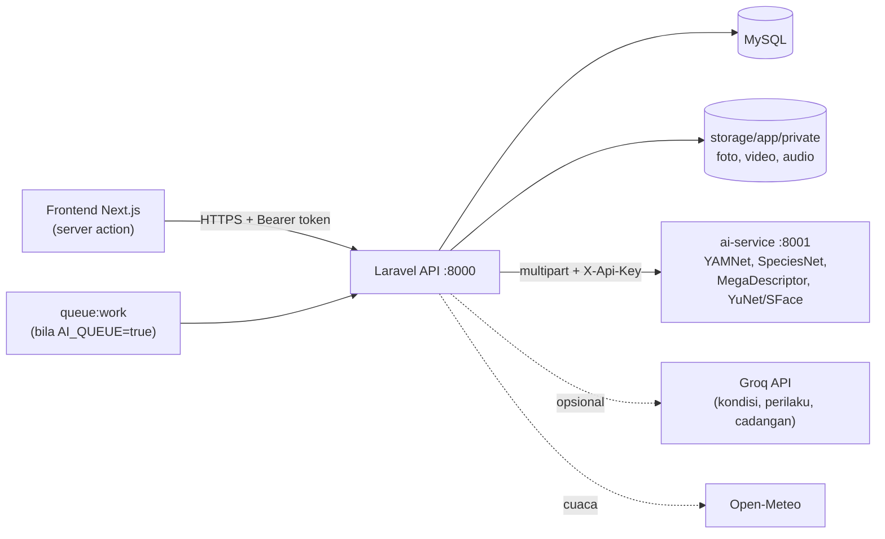
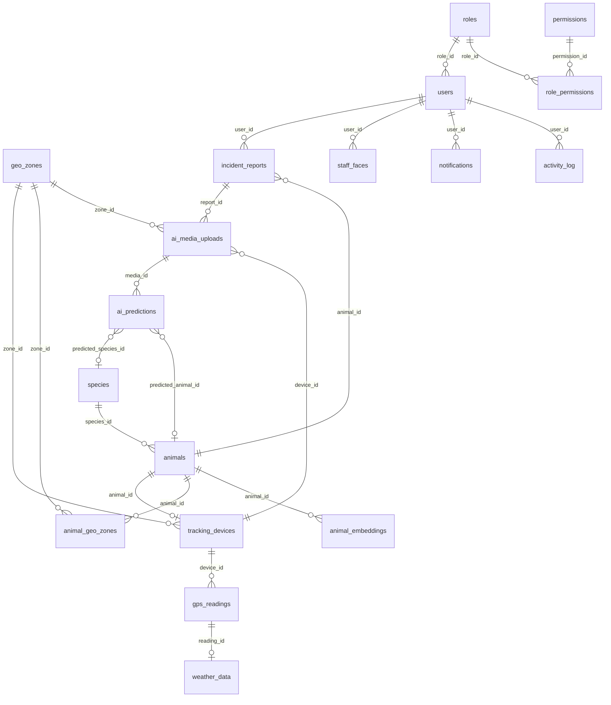
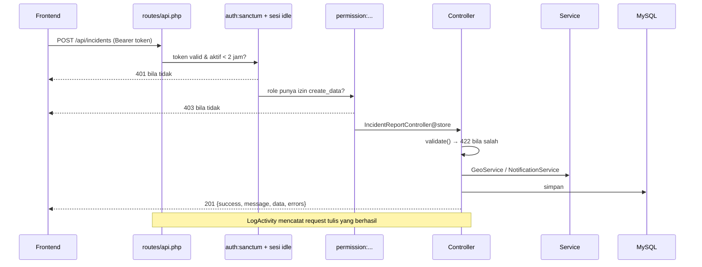
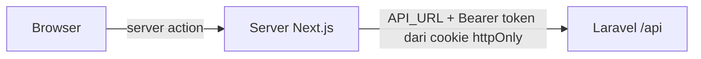
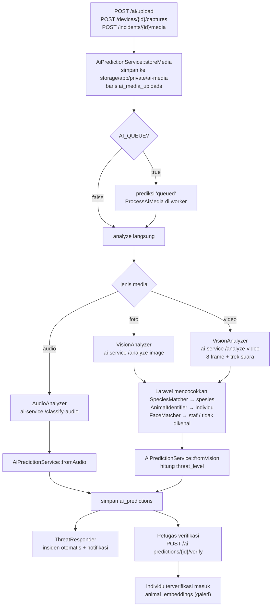

# Arsitektur Backend Wildlife Tracking

Panduan untuk anggota baru tim backend: cara kerja aplikasi Laravel ini dari request masuk sampai data tersimpan, isi setiap folder dan file, struktur `.env`, hubungan dengan frontend, dan cara kerja AI.

Diperbarui: 23 November 2026 · Laravel 13 + Sanctum · MySQL/MariaDB · ai-service Python (FastAPI).

Dokumen lain di folder `docs/`:

| Dokumen | Isi |
|---|---|
| [`DOKUMENTASI.md`](DOKUMENTASI.md) | Daftar fitur, riwayat perubahan, hak akses per role, hasil audit |
| [`API.md`](API.md) | Kontrak semua endpoint (request & response) |
| [`DEPLOY.md`](DEPLOY.md) | Menjadikan PC sebagai server tim lewat Cloudflare Tunnel |
| [`../ai-service/README.md`](../ai-service/README.md) | Setup dan kontrak layanan AI Python |
| [`../ai-service/training/README.md`](../ai-service/training/README.md) | Data latih dan hasil uji akurasi tiap model |

---

## 1. Gambaran besar

Backend terdiri dari dua program yang berjalan berdampingan:

1. **Laravel** (PHP, port 8000): API REST, autentikasi, hak akses, database, logika bisnis, notifikasi.
2. **ai-service** (Python, port 8001): model AI terlatih (suara, deteksi satwa/manusia, spesies, individu satwa, wajah). Hanya dipanggil oleh Laravel, tidak pernah oleh frontend.



Prinsipnya:

- **Database adalah sumber kebenaran.** Semua hasil AI disimpan di tabel `ai_predictions`; frontend hanya membaca dari API.
- **Berkas media tidak publik.** Disimpan di `storage/app/private` dan hanya bisa diambil lewat endpoint yang butuh token.
- **Setiap endpoint dijaga izin** (`permission:` middleware) yang dibaca dari tabel `role_permissions`.

---

## 2. Struktur folder

```
wildlife-tracking-backend/
├── app/                  Kode aplikasi Laravel
│   ├── Console/Commands/ Perintah artisan buatan proyek
│   ├── Http/
│   │   ├── Controllers/Api/  Satu controller per kelompok endpoint
│   │   ├── Middleware/       Cek izin, cek role, log aktivitas
│   │   └── Traits/           Format respons JSON standar
│   ├── Jobs/             Pekerjaan antrean (analisis AI di background)
│   ├── Models/           Satu model Eloquent per tabel
│   ├── Providers/        Pengaturan saat aplikasi start
│   └── Services/         Logika bisnis (dipakai banyak controller)
│       └── Ai/           Semua logika AI di sisi Laravel
├── ai-service/           Layanan AI Python (FastAPI)
│   ├── heads/            Classifier suara yang dilatih proyek ini (.npz)
│   ├── models/           Bobot model yang diunduh (tidak di-commit)
│   └── training/         Skrip latih & evaluasi + hasilnya
├── bootstrap/            Start aplikasi: routing, alias middleware, format error
├── config/               Konfigurasi Laravel (membaca .env)
├── database/
│   ├── migrations/       Skema tabel (urut berdasarkan tanggal di nama file)
│   ├── seeders/          Data contoh untuk pengembangan
│   └── factories/        Pembuat data palsu untuk test
├── docs/                 Dokumentasi
├── public/               Pintu masuk web (index.php)
├── routes/               Daftar URL → controller
├── scripts/              Skrip PowerShell (setup ai-service, server tim)
├── storage/              Log, cache, berkas upload (tidak di-commit)
├── tests/                Test otomatis (PHPUnit/Pest)
├── vendor/               Paket composer (tidak di-commit; dibuat `composer install`)
├── .env                  Konfigurasi lokal (tidak di-commit)
└── .env.example          Contoh .env (di-commit)
```

---

## 3. Fungsi setiap file

### 3.1 `routes/`

| File | Fungsi |
|---|---|
| `api.php` | **Semua endpoint API.** Didaftarkan dua kali: `/api/...` (dipakai frontend) dan `/api/v1/...`. Dikelompokkan per izin, mis. `Route::middleware('permission:manage_master_data')`. Beberapa resource punya alias (`devices` = `tracking-devices`, `incidents` = `incident-reports`) |
| `web.php` | Halaman `/` bawaan Laravel (tidak dipakai) |
| `console.php` | Perintah artisan sederhana bawaan |

Untuk melihat semua route: `php artisan route:list --path=api`.

### 3.2 `bootstrap/`

| File | Fungsi |
|---|---|
| `app.php` | Mendaftarkan route, alias middleware (`role`, `permission`, `log.activity`), endpoint health `/up`, dan **mengubah semua error menjadi JSON** `{success:false, message, data:null, errors}` (422 validasi, 401 sesi, 403 izin, 404, 500) |
| `providers.php` | Daftar service provider |

### 3.3 `app/Http/Controllers/Api/`

Controller hanya memvalidasi input, memanggil model/service, lalu mengembalikan JSON. Semua mewarisi `ApiController` (memakai trait `ApiResponse`).

| File | Endpoint | Fungsi |
|---|---|---|
| `ApiController.php` | – | Kelas dasar; menyediakan `success()`, `error()`, `list()` |
| `AuthController.php` | `/login`, `/logout`, `/me`, `/auth/refresh` | Login dengan email/username, membuat token Sanctum, batas 5 percobaan, data user + daftar izin |
| `UserController.php` | `/users`, `/me`, `/me/password` | Kelola akun (admin), profil sendiri, ganti password, cabut sesi, riwayat aktivitas user |
| `RoleController.php` | `/roles` | Kelola role dan izin per role; role bawaan dikunci |
| `PermissionController.php` | `/permissions` | Daftar izin (baca saja) |
| `ActivityLogController.php` | `/activity-logs` | Log aktivitas (admin) |
| `DashboardController.php` | `/dashboard`, `/dashboard/stats`, `/dashboard/charts` | Statistik ringkas untuk dashboard |
| `SpeciesController.php` | `/species` | CRUD spesies |
| `AnimalController.php` | `/animals` | CRUD satwa, jejak GPS, kunjungan zona, insiden, observasi AI, **galeri foto referensi** untuk re-identifikasi |
| `TrackingDeviceController.php` | `/devices` | CRUD perangkat (GPS/kamera/audio), pasang ke satwa, status, kondisi, telemetri, **unggah rekaman kamera/audio** |
| `GpsReadingController.php` | `/gps-readings` | Simpan titik GPS (satu atau bulk), memicu geofence |
| `GeoZoneController.php` | `/geo-zones` | CRUD zona (radius atau poligon GeoJSON), satwa/perangkat dalam zona, cari zona dari koordinat |
| `AnimalGeoZoneController.php` | `/animal-geo-zone-visits` | Catatan satwa masuk/keluar zona |
| `IncidentReportController.php` | `/incidents` | CRUD laporan insiden, lampiran media, status sinkron |
| `NotificationController.php` | `/notifications` | Notifikasi milik user login: baca, tandai dibaca, hapus |
| `AiPredictionController.php` | `/ai/upload`, `/ai-predictions`, `/media-uploads` | Upload media ke AI, daftar/detail prediksi, verifikasi petugas, ulangi analisis, hapus |
| `AiInsightController.php` | `/ai/summary-report`, `/ai/recap`, `/ai/threats`, `/ai/health`, `/ai/vocabulary`, `/ai/detect-objects` | Ringkasan dan rekap AI, daftar ancaman, status layanan AI, label bahasa Indonesia |
| `StaffFaceController.php` | `/staff-faces` | Galeri wajah staf (admin) |
| `AggregateReportController.php` | `/aggregate-reports` | Buat/simpan/unduh laporan harian/mingguan/bulanan |
| `ExportController.php` | `/export/...` | Ekspor CSV/GeoJSON; sel teks berbahaya diberi awalan `'` (anti formula injection) |
| `WeatherDataController.php` | `/weather-data` | Data cuaca, ambil dari Open-Meteo, impor dari perangkat |
| `TourismCatalogController.php` | `/tourism/*` (publik) | Katalog rute, profil & jadwal pemandu, tarif, simulasi harga |
| `VisitorBookingController.php` | `/visitor/bookings` | Pemesanan milik pengunjung: pesan, batal, bukti bayar, tiket QR, ulasan |
| `TourismAdminController.php` | `/tourism/admin/*` | Kelola rute, pemandu, shift, tarif, libur, pemesanan, verifikasi bayar, ulasan |
| `TicketCheckInController.php` | `/tourism/check-in` | Check-in tiket di pintu masuk |
| `PosController.php` | `/pos/*` | POS loket: sesi kas, jual walk-in, void, struk, laporan harian |
| `WildlifeCatalogController.php` | `/wildlife/*` (publik) | Ensiklopedia satwa: profil spesies & model 3D tanpa data individu/lokasi |
| `MidtransNotificationController.php` | `/payments/midtrans/notification` | Notifikasi Midtrans (cek tanda tangan → cek status ulang) |
| `DeviceTokenController.php` | `/devices/{id}/api-token` | Token API perangkat lapangan |
| `PaymentWebhookController.php` | `/payments/webhook` | Notifikasi payment gateway bertanda tangan HMAC |

### 3.4 `app/Http/Middleware/` dan `Traits/`

| File | Fungsi |
|---|---|
| `CheckPermission.php` | `permission:create_data,update_data` → lolos bila role user punya salah satu izin; kalau tidak `403` |
| `CheckRole.php` | `role:administrator_sistem` → cek nama role (jarang dipakai; utamakan izin) |
| `LogActivity.php` | Mencatat setiap request tulis yang berhasil ke `activity_log` (tanpa isi body, agar password tidak tercatat) |
| `Traits/ApiResponse.php` | Format respons standar. `list()` mengembalikan array polos di `data`; info halaman di header `X-Total-Count`, `X-Current-Page`, `X-Per-Page`, `X-Last-Page` |

### 3.5 `app/Models/`

Satu model = satu tabel. Primary key memakai nama `<entitas>_id` (mis. `animal_id`), bukan `id`.

| Model | Tabel | Isi |
|---|---|---|
| `User` | `users` | Akun petugas (soft delete) |
| `Role`, `Permission`, `RolePermission` | `roles`, `permissions`, `role_permissions` | RBAC: 4 role bawaan, 11 izin |
| `Species` | `species` | Master spesies (soft delete) |
| `Animal` | `animals` | Individu satwa (soft delete) |
| `TrackingDevice` | `tracking_devices` | Kalung GPS, kamera jebak, perekam suara |
| `GpsReading` | `gps_readings` | Titik lokasi dari kalung |
| `GeoZone` | `geo_zones` | Zona kawasan (soft delete) |
| `AnimalGeoZone` | `animal_geo_zones` | Kunjungan satwa ke zona (`entered_at`, `exited_at`) |
| `IncidentReport` | `incident_reports` | Laporan insiden manual & otomatis dari AI (soft delete) |
| `Notification` | `notifications` | Notifikasi per user |
| `AiMediaUpload` | `ai_media_uploads` | Berkas yang dikirim ke AI + asal (perangkat, zona, insiden, koordinat) |
| `AiPrediction` | `ai_predictions` | **Hasil AI** per media (lihat bagian 7.5) |
| `AnimalEmbedding` | `animal_embeddings` | Vektor penampilan satwa untuk re-identifikasi (vektor disembunyikan dari API) |
| `StaffFace` | `staff_faces` | Vektor wajah staf (data biometrik, disembunyikan dari API) |
| `TicketPrice`, `PublicHoliday` | `ticket_prices`, `public_holidays` | Tarif PNBP & hari libur |
| `TourRoute`, `TourGuide`, `GuideShift` | `tour_routes`, `tour_guides`, `guide_shifts` | Paket tur, profil pemandu, jadwal shift |
| `Booking`, `BookingParticipant`, `Payment`, `TourReview` | `bookings`, `booking_participants`, `payments`, `tour_reviews` | Pemesanan, peserta, transaksi, ulasan |
| `PosSession` | `pos_sessions` | Sesi kas kasir loket (modal awal, kas seharusnya, hitungan fisik, selisih) |
| `AggregateReport` | `aggregate_reports` | Laporan periodik tersimpan |
| `WeatherData` | `weather_data` | Cuaca per titik GPS |
| `ActivityLog` | `activity_log` | Jejak aktivitas user |

### 3.6 `app/Services/`

Logika yang dipakai lebih dari satu tempat. Controller memanggil service, bukan sebaliknya.

| File | Fungsi |
|---|---|
| `ApiSessionService.php` | Sesi berakhir setelah 2 jam tidak aktif. Waktu aktivitas terakhir disimpan di cache; token yang idle dihapus |
| `GeoService.php` | Hitung jarak (haversine), cek titik di dalam radius/poligon, validasi GeoJSON |
| `GeofenceService.php` | Dipanggil setiap ada titik GPS baru: perbarui status perangkat, catat masuk/keluar zona, kirim peringatan bila satwa masuk zona rawan |
| `DeviceHealthService.php` | Kirim notifikasi bila baterai < 20%, sinyal lemah, atau perangkat rusak/hilang |
| `NotificationService.php` | Kirim notifikasi ke semua user aktif dengan role tertentu; notifikasi identik dalam 30 menit tidak dikirim ulang |
| `MonitoringStatsService.php` | Hitung statistik untuk dashboard, laporan agregat, dan ringkasan AI |
| `WeatherService.php` | Ambil cuaca historis dari Open-Meteo (gratis, tanpa kunci) |
| `AiPredictionService.php` | **Orkestrator AI**: simpan berkas, jalankan analisis (langsung atau antrean), ubah hasil model menjadi baris `ai_predictions`, simpan embedding, panggil `ThreatResponder` |
| `AiSummaryService.php` | Ringkasan eksekutif teks (Groq) + statistik + rekomendasi |
| `AiRecapService.php` | Rekap Data AI per periode: total, spesies, individu, wajah, suara, ancaman, per zona, per hari |
| `Tourism/PricingService.php` | Hitung harga di server: tiket masuk per orang per hari (tarif hari kerja/libur), jasa pemandu, drone |
| `Tourism/BookingService.php` | Pesan dengan kunci kuota, kedaluwarsa, bukti bayar, lunas/tolak, batal, token tiket HMAC, check-in |
| `Tourism/PosService.php` | Sesi kas kasir, penjualan walk-in langsung lunas, kembalian, void, tutup kas + selisih, ringkasan (PNBP vs jasa pemandu) |
| `Tourism/MidtransService.php` | Buat transaksi Snap, validasi tanda tangan, ambil ulang status, tandai lunas |
| `RegistrationGuard.php` | CAPTCHA hitungan bertanda tangan HMAC untuk pendaftaran |
| `Tourism/TourismClock.php` | Waktu lokal kawasan (`TOURISM_TIMEZONE`, default WIB) untuk jam shift & "hari ini"; app tetap UTC |

### 3.7 `app/Services/Ai/`

| File | Fungsi |
|---|---|
| `WildlifeVisionClient.php` | Klien HTTP ke ai-service: `analyzeImage`, `analyzeVideo`, `embed` (satwa), `embedFace` (wajah). Mengirim `X-Api-Key` bila diisi |
| `VisionAnalyzer.php` | Analisis foto/video: model terlatih dari ai-service, lalu Groq untuk kondisi/perilaku/senjata. Bila ai-service tidak bisa dihubungi, pakai Groq saja |
| `AudioAnalyzer.php` | Analisis rekaman: ai-service (YAMNet + classifier terlatih), cadangan Groq Whisper, lalu aturan akustik |
| `AudioFeatureExtractor.php` | Ciri akustik sederhana dari WAV (cadangan terakhir) |
| `SpeciesMatcher.php` | Cocokkan nama/takson hasil AI ke tabel `species` |
| `AnimalIdentifier.php` | Tebak individu satwa dari kemiripan penampilan, GPS ±6 jam, zona, ciri fisik |
| `FaceMatcher.php` | Cocokkan wajah dengan galeri `staff_faces`: ≥0,40 staf, 0,30–0,40 "kemungkinan", sisanya "Tidak dikenal / pengunjung" |
| `ThreatResponder.php` | Buat insiden otomatis + notifikasi bila ancaman sedang ke atas atau satwa terluka |
| `AnalysisVocabulary.php` | Kode baku (kondisi, perilaku, kategori suara, tingkat ancaman) dan label bahasa Indonesia |
| `GroqClient.php` | Klien Groq; aman walau kunci kosong (cek `isConfigured()`) |

### 3.8 File lain di `app/`

| File | Fungsi |
|---|---|
| `Jobs/ProcessAiMedia.php` | Analisis AI di background bila `AI_QUEUE=true`. Status prediksi: `queued` → `processing` → hasil |
| `Console/Commands/ImportStaffFaces.php` | `php artisan staff:import-faces <folder> [--replace]`: daftarkan wajah staf dari folder `face_<nama>/` |
| `Providers/AppServiceProvider.php` | Parameter ID route wajib angka; memasang pengecekan sesi idle ke Sanctum |

### 3.9 `config/`

File bawaan Laravel yang membaca `.env`. Yang diubah proyek ini:

| File | Yang penting |
|---|---|
| `services.php` | Semua pengaturan AI: `groq`, `ai` (antrean), `ai_vision`, `ai_audio` |
| `sanctum.php` | `idle_timeout` (dari `API_IDLE_TIMEOUT`) |
| `cors.php` | Origin frontend dari `FRONTEND_URLS` |
| `filesystems.php` | Disk `local` = `storage/app/private` |

### 3.10 `database/`

**Migrasi** (urut eksekusi):

| File | Membuat |
|---|---|
| `2026_11_09_*` (18 file) | Tabel inti: roles, users, species, permissions, geo_zones, role_permissions, animals, tracking_devices, gps_readings, animal_geo_zones, incident_reports, notifications, aggregate_reports, weather_data, activity_log, ai_media_uploads, ai_predictions, personal_access_tokens |
| `2026_11_16_145828_create_cache_table` | Tabel cache (dipakai sesi idle) |
| `2026_11_22_000001_create_jobs_table` | Tabel antrean |
| `2026_11_22_000002_create_animal_embeddings_table` | Galeri re-identifikasi satwa |
| `2026_11_23_000001_create_staff_faces_and_face_results` | Galeri wajah staf + kolom `faces`, `staff_face_count`, `unknown_face_count` di `ai_predictions` |
| `2026_11_24_000001_create_tourism_tables` | Modul wisata: tarif, libur, rute, pemandu, shift, pemesanan, peserta, pembayaran, ulasan |
| `2026_11_26_000001_add_profile_and_model_to_species` | Profil ensiklopedia spesies + model 3D & hotspot |
| `2026_11_25_000001_add_pos_to_tourism` | POS: `pos_sessions`, kanal penjualan & kasir di `bookings`, metode tunai/EDC + kembalian di `payments` |

**Seeder:** `DatabaseSeeder` memanggil `RolePermissionSeeder` → `UserSeeder` (6 akun, password `password123`) → `SpeciesSeeder` → `GeoZoneSeeder` → `AnimalSeeder` → `TrackingDeviceSeeder` → `GpsReadingSeeder` → `IncidentReportSeeder` → `NotificationSeeder` → `AiSampleSeeder` → `TourismSeeder` (tarif PP 36/2024, 4 rute, 4 pemandu, shift hari ini + 14 hari).

### 3.11 `ai-service/`

| File | Fungsi |
|---|---|
| `app.py` | Server FastAPI: `/classify-audio`, `/analyze-image`, `/analyze-video`, `/embed`, `/embed-face`, `/health`. Model dimuat sekali lalu disimpan di memori |
| `audio_pipeline.py`, `audio_heads.py`, `yamnet_model.py`, `audio_io.py`, `categories.py` | Suara: decode audio (ffmpeg), YAMNet, classifier tembakan & kategori yang dilatih proyek ini, aturan veto |
| `vision.py` | SpeciesNet (MegaDetector + classifier spesies) dengan filter geografis Indonesia |
| `reid.py` | MegaDescriptor: vektor penampilan untuk mengenali individu satwa |
| `faces.py` | YuNet (deteksi wajah) + SFace (vektor wajah) |
| `download_model.py` | Unduh semua model ke `models/` dengan cek sha256 |
| `heads/*.npz` | Bobot classifier suara hasil latihan |
| `training/` | Skrip latih & evaluasi; `README.md` berisi angka akurasi |

### 3.12 `tests/`

| File | Menguji |
|---|---|
| `AuthTest`, `SessionTimeoutTest` | Login, token, sesi 2 jam |
| `RbacTest`, `SecurityAuditTest` | Hak akses dan temuan audit keamanan |
| `MasterDataTest` | CRUD master data, GPS, geofence |
| `AiPipelineTest`, `AiServiceIntegrationTest`, `VisionModelsIntegrationTest`, `FaceRecognitionAndRecapTest` | Alur AI dengan respons ai-service/Groq tiruan |
| `Unit/AnalysisTest` | Kosakata & pencocokan |

Jalankan: `php artisan test` (86 test).

---

## 4. Database

### 4.1 Relasi utama



Satu kalung GPS hanya terpasang ke satu satwa (`tracking_devices.animal_id` unik). Kamera dan perekam suara tidak punya satwa; lokasinya lewat `zone_id` atau koordinat.

### 4.2 Aturan yang perlu dijaga

- **Skema hanya diubah lewat file migrasi baru.** Jangan mengedit migrasi lama yang sudah dipakai tim.
- **`migrate:fresh --seed` menghapus semua data**, termasuk galeri wajah staf. Di PC pengembangan boleh; di PC server tim pakai `php artisan migrate --force`.
- **Soft delete** di `users`, `species`, `animals`, `geo_zones`, `incident_reports`: baris tidak benar-benar terhapus (`deleted_at` terisi). Validasi `exists` di controller sudah mengabaikan baris yang terhapus.
- **Kolom JSON** (`ai_predictions.faces`, `detected_objects`, `raw_response`, `animal_embeddings.vector`, `staff_faces.vector`, `geo_zones.polygon_geojson`) dibaca sebagai array lewat `casts()` di model.
- **Nilai baku** (status, tingkat ancaman, kategori suara) disimpan sebagai kode bahasa Inggris; label tampilan ada di `AnalysisVocabulary`.

### 4.3 Query yang sering berguna

```sql
-- Prediksi AI terbaru beserta ancaman dan wajah
SELECT prediction_id, media_id, processing_status, threat_level, sound_category,
       staff_face_count, unknown_face_count, model_version, processed_at
FROM ai_predictions ORDER BY processed_at DESC LIMIT 20;

-- Izin tiap role
SELECT r.name_role, p.name_permission
FROM role_permissions rp
JOIN roles r ON r.role_id = rp.role_id
JOIN permissions p ON p.permission_id = rp.permission_id
ORDER BY r.name_role;

-- Satwa yang sedang berada di dalam zona
SELECT a.name_animal, z.zone_name, v.entered_at
FROM animal_geo_zones v
JOIN animals a ON a.animal_id = v.animal_id
JOIN geo_zones z ON z.zone_id = v.zone_id
WHERE v.exited_at IS NULL;

-- Jumlah foto wajah per staf
SELECT name, COUNT(*) FROM staff_faces GROUP BY name;
```

---

## 5. Struktur `.env`

| Kelompok | Variabel | Keterangan |
|---|---|---|
| Aplikasi | `APP_NAME`, `APP_ENV`, `APP_KEY`, `APP_DEBUG`, `APP_URL` | `APP_KEY` dibuat `php artisan key:generate`. `APP_DEBUG=false` di server yang diakses tim (stack trace tidak bocor) |
| Database | `DB_CONNECTION=mysql`, `DB_HOST`, `DB_PORT`, `DB_DATABASE`, `DB_USERNAME`, `DB_PASSWORD` | |
| Sesi API | `API_IDLE_TIMEOUT=120` | Menit tanpa aktivitas sebelum token ditolak |
| CORS | `FRONTEND_URLS=http://localhost:3000,http://127.0.0.1:3000` | Origin browser yang boleh memanggil API |
| Cache & antrean | `CACHE_STORE=database`, `QUEUE_CONNECTION=database` | Keduanya memakai tabel MySQL |
| AI: mode | `AI_QUEUE=false` | `true`: upload langsung dibalas `queued`, analisis di worker (`php artisan queue:work --queue=ai,default`) |
| AI: ai-service | `AI_AUDIO_SERVICE_URL`, `AI_VISION_SERVICE_URL` (biasanya `http://127.0.0.1:8001`), `AI_AUDIO_SERVICE_TOKEN`, `AI_VISION_SERVICE_TOKEN`, `AI_AUDIO_SERVICE_MODEL` | Token wajib sama dengan `AI_SERVICE_TOKEN` di ai-service bila diisi |
| AI: ambang | `AI_COUNTRY=IDN`, `AI_REID_THRESHOLD=0.6`, `AI_FACE_THRESHOLD=0.40`, `AI_FACE_POSSIBLE_THRESHOLD=0.30` | Dikalibrasi; lihat `ai-service/training/README.md` |
| Groq (opsional) | `GROQ_API_KEY`, `GROQ_VISION_MODEL`, `GROQ_TEXT_MODEL`, `GROQ_AUDIO_MODEL`, `GROQ_TIMEOUT` | Kondisi/perilaku satwa, ringkasan teks, cadangan bila ai-service mati. **Jangan pernah commit kuncinya** |
| Lain | `FFMPEG_PATH=ffmpeg`, `FILESYSTEM_DISK=local`, `MAIL_*`, `REDIS_*`, `AWS_*` | `MAIL/REDIS/AWS` tidak dipakai saat ini |

Setelah mengubah `.env`, selalu jalankan `php artisan config:clear` dan restart `php artisan serve` (serta worker bila ada).

---

## 6. Perjalanan satu request



**Bentuk respons selalu sama:**

```json
{ "success": true, "message": "OK", "data": { ... }, "errors": null }
```

Error validasi: status `422`, `errors` berisi `{ "nama_field": ["pesan"] }`.

**Autentikasi:** `POST /api/login` dengan `{email, password}` (atau `username`) → `data.token`. Kirim di setiap request: `Authorization: Bearer <token>`. Token ditolak bila tidak dipakai lebih dari `API_IDLE_TIMEOUT` menit, akun dinonaktifkan, atau password direset admin.

**Izin per role** (ringkas; lengkap di `DOKUMENTASI.md` bagian 3):

| Izin | Lapangan | Peneliti | Admin | Kebijakan |
|---|:-:|:-:|:-:|:-:|
| `view_data`, `upload_media` | ✓ | ✓ | ✓ | ✓ |
| `create_data`, `update_data`, `verify_ai` | ✓ | ✓ | ✓ | |
| `manage_master_data` | | ✓ | ✓ | |
| `view_reports`, `export_data` | | ✓ | ✓ | ✓ |
| `delete_data`, `manage_users`, `manage_roles` | | | ✓ | |

---

## 7. Hubungan frontend dengan backend

Repo frontend: `wildlife-tracking-frontend` (Next.js 16).



- Browser **tidak** memanggil Laravel langsung. Komponen memanggil server action di `services/backend-actions.ts`, lalu server Next.js meneruskan request ke `API_URL` dengan token yang disimpan di cookie httpOnly. Karena itu CORS jarang menjadi masalah dan token tidak terlihat di JavaScript.
- `API_URL` di `.env.local` frontend:
  - backend lokal: `http://127.0.0.1:8000/api`
  - server tim: `https://<alamat-tunnel>.trycloudflare.com/api` (berganti setiap tunnel dinyalakan ulang)
- Berkas (foto, CSV, GeoJSON) dikirim server Next ke browser sebagai base64.
- Menu frontend dibangun dari tabel izin yang sama (`lib/permissions.ts` di repo frontend). **Bila izin role diubah di backend, sesuaikan juga file itu.**
- Kontrak yang harus dijaga agar frontend tidak rusak: bentuk `{success, message, data, errors}`, list berupa array di `data`, nama kolom `<entitas>_id`, kode status/ancaman yang sama. Perubahan kontrak wajib dicatat di `DOKUMENTASI.md` bagian "Apa yang diubah".

---

## 8. Cara kerja AI

### 8.1 Alur upload sampai hasil



### 8.2 Apa yang dikerjakan ai-service dan apa yang dikerjakan Laravel

| Tugas | ai-service (Python) | Laravel (PHP) |
|---|---|---|
| Suara | YAMNet + classifier terlatih → kategori (tembakan, gergaji, mesin, api, kendaraan, anjing, suara manusia, satwa, alam) | Ubah ke `sound_category`, tentukan ancaman |
| Satwa/manusia/kendaraan | MegaDetector → kotak + jumlah | Simpan `detected_objects`, `individual_count` |
| Spesies | SpeciesNet → takson | `SpeciesMatcher` cocokkan ke tabel `species` |
| Individu satwa | MegaDescriptor → vektor 768 angka | `AnimalIdentifier` bandingkan dengan `animal_embeddings` + GPS/zona |
| Wajah | YuNet + SFace → kotak + vektor 128 angka | `FaceMatcher` bandingkan dengan `staff_faces` |
| Kondisi, perilaku, senjata/jerat/api | – | Groq vision (bila `GROQ_API_KEY` diisi) |

Pemisahan ini disengaja: **galeri (staf, satwa) disimpan di database Laravel**, bukan di ai-service. ai-service hanya menghitung vektor; pencocokan dan keputusan dilakukan Laravel. Karena itu setiap database (setiap anggota tim) punya galerinya sendiri.

### 8.3 Penentuan tingkat ancaman (`threat_level`)

Nilai tertinggi dari aturan berikut (`AiPredictionService::fromVision` / `fromAudio`, `AnalysisVocabulary`):

| Temuan | Tingkat | Insiden otomatis |
|---|---|---|
| Tembakan, senjata, jerat | `critical` | `perburuan` |
| Gergaji mesin, pohon tumbang, penebangan | `high` | `perambahan` |
| Api/asap | `high` | `kebakaran_hutan` |
| Mesin berat; kemungkinan tembakan beruntun | `medium` | `perambahan` / tidak |
| Orang **bukan staf** di koridor atau lokasi tak diketahui | `medium` | tidak (notifikasi) |
| Kendaraan, anjing | `low`–`medium` | tidak |
| Satwa terluka | `medium` | `kesehatan_satwa` |

Staf yang wajahnya dikenali **tidak** memicu ancaman aktivitas manusia.

### 8.4 Cadangan bila ai-service mati

- Foto/video: Groq vision saja (`model_version` diawali `groq:`); wajah staf dan individu satwa tidak dicocokkan.
- Suara: Groq Whisper, lalu aturan ciri akustik WAV.
- Tanpa Groq: prediksi `failed` dengan pesan penyebab; bisa diulang lewat `POST /ai-predictions/{id}/retry`.

### 8.5 Kolom penting `ai_predictions`

| Kolom | Isi |
|---|---|
| `processing_status` | `queued`, `processing`, `completed`, `unrecognized`, `failed` |
| `verification_status` | `pending`, `confirmed`, `rejected` |
| `predicted_species_id`, `confidence` | Spesies + keyakinan 0–1 |
| `predicted_animal_id`, `animal_match_method`, `animal_match_confidence` | Individu dan cara mengenalinya |
| `faces`, `staff_face_count`, `unknown_face_count` | Wajah (tanpa vektor) dan jumlahnya |
| `sound_category`, `sound_label` | Hasil suara (audio, dan trek suara video) |
| `threat_level` | `none` → `critical` |
| `detected_objects`, `raw_response` | Detail mentah untuk audit |
| `model_version` | Model yang dipakai; unik per media (`media_id + model_version`) |

### 8.6 Menjalankan ai-service

Sekali per komputer: `powershell -ExecutionPolicy Bypass -File scripts\setup-ai-service.ps1` (Python 3.12, ±3 GB disk). Lalu:

```powershell
cd ai-service; .\.venv\Scripts\Activate.ps1; uvicorn app:app --host 127.0.0.1 --port 8001
```

Cek `http://127.0.0.1:8001/health` → `audio`, `vision`, `reid`, `faces` harus `"loaded": true`. Setelah database di-reset, daftarkan ulang wajah staf: `php artisan staff:import-faces <folder> --replace`.

---

## 9. Proses otomatis lain

| Pemicu | Yang terjadi | Kode |
|---|---|---|
| Titik GPS baru | Perbarui `last_seen` perangkat, catat masuk/keluar zona, peringatan zona rawan, cek baterai | `GpsReadingController` → `GeofenceService`, `DeviceHealthService` |
| Telemetri/rekaman perangkat | Cek baterai & sinyal | `DeviceHealthService` |
| Hasil AI dengan ancaman | Insiden otomatis (`source` ≠ `manual`) + notifikasi ke role terkait | `ThreatResponder`, `NotificationService` |
| Request tulis berhasil | Baris `activity_log` | `LogActivity` |
| Request dengan token | Perbarui waktu aktivitas sesi di cache | `ApiSessionService` |
| `POST /weather-data/sync` | Ambil cuaca untuk titik GPS tanpa data cuaca | `WeatherService` |

---

## 10. Menambah fitur: urutan kerja

1. **Skema**: buat migrasi baru `php artisan make:migration ...`; jangan ubah migrasi lama.
2. **Model**: `$table`, `$primaryKey`, `$fillable`, `casts()`, relasi.
3. **Logika**: bila dipakai lebih dari satu tempat, letakkan di `app/Services/`.
4. **Controller**: validasi dengan `$request->validate([...])`, kembalikan `$this->success()` / `$this->list()` / `$this->error()`.
5. **Route**: daftarkan di `routes/api.php` di dalam grup izin yang tepat.
6. **Test**: tambah test di `tests/Feature/`, jalankan `php artisan test`.
7. **Data**: `php artisan migrate:fresh --seed` di lokal.
8. **Dokumentasi**: catat di `DOKUMENTASI.md` (apa yang diubah + dampak ke FE) dan `API.md`.
9. **Git**: commit gaya conventional singkat (`feat: ...`, `fix: ...`), push ke `development`, minta persetujuan sebelum `main`.

Perintah harian:

```bash
php artisan serve                 # API di :8000
php artisan test                  # 86 test
php artisan route:list --path=api # semua endpoint
php artisan migrate:fresh --seed  # reset database lokal
php artisan tinker                # coba query Eloquent
tail -f storage/logs/laravel.log  # log error
```


### Tambahan 2026-11-26

| Berkas | Fungsi |
|---|---|
| `app/Http/Middleware/RestrictDeviceTokens.php` | Token perangkat hanya boleh mengirim data perangkatnya sendiri |
| `app/Support/GlbValidator.php` | Validasi unggahan model 3D `.glb` (header, panjang, JSON, tanpa URI eksternal) |
| `app/Console/Commands/SecurityCheck.php` | `php artisan security:check`: debug, password bawaan, kunci, proxy, pembayaran |
| `app/Console/Commands/ResetDefaultPasswords.php` | `php artisan users:reset-default-passwords`: ganti password seed + cabut token |
| `app/Console/Commands/PruneIdleTokens.php` | `php artisan tokens:prune-idle` (terjadwal tiap jam) |
| `database/seeders/data/species_profiles.php` | Isi ensiklopedia 8 satwa |
| `database/seeders/species-models/*.glb` | Model 3D ilustratif + `*.hotspots.json` |
| `tools/species-models/generate.py` | Generator model ilustratif (Python + trimesh) |
